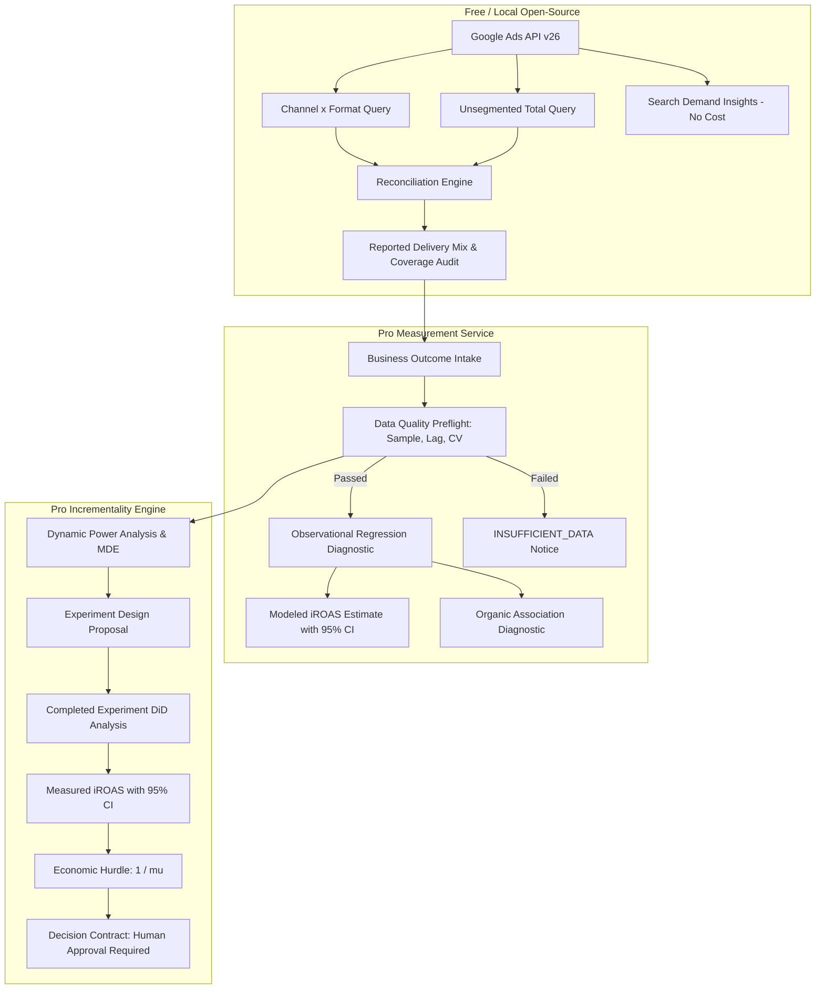

# PMax Sentry — Delivery Observability & Incrementality Measurement Suite

**PMax Sentry** helps advertisers inspect Performance Max delivery and assess whether reported results appear incremental to business outcomes.

Built strictly according to the developer specification:
- **Free open-source CLI & Python core:** `pmax-sentry` / `pmax-sentry-core`
- **Hosted Pro measurement service:** `pmax-sentry-pro` / `pro_api`
- **Model Context Protocol (MCP) server:** `pmax-sentry-mcp`

---

## Three Evidence Stages



---

## Core Guarantees & Constraints

- **Preserves Dimensions:** Channel and format dimensions are kept separate. Overlapping product-data and video units are never added as independent channel spend.
- **Strict Reconciliation:** Compares segmented cost against campaign totals. Raw difference is preserved; it is never hidden with `max(0, diff)` or labeled "Display", "Video", or "waste".
- **Zero Fabricated Spend:** Search-term insight queries never request `cost_micros`. No spend subtraction is performed.
- **Evidence Labeling:** Metrics are strictly partitioned into `REPORTED`, `OBSERVATIONAL`, or `EXPERIMENTAL`.
- **Dynamic Power:** No hardcoded 14-day or 4-cell defaults; experiment durations and sample sizes are calculated from account variance and conversion lag.
- **Economics:** Break-even hurdle = $1 / \mu$ where $\mu$ is the advertiser's contribution margin rate. Marginal iROAS identifies profit-maximizing spend, not average ROAS.
- **No Live Mutations in v1:** All tools and APIs are read-only. Live campaign write mutations are strictly out of scope.

---

## Quickstart

### 1. Install CLI
```bash
pip install -e packages/pmax_sentry_core -e packages/pmax_sentry_cli
```

### 2. Run Campaign Audit
```bash
pmax-audit campaigns --customer-id 1234567890
```

### 3. Generate Delivery Mix Report
```bash
pmax-audit report --customer-id 1234567890 --start-date 2026-10-01 --end-date 2026-10-30
```

### 4. Run Search Demand Insights
```bash
pmax-audit insights --customer-id 1234567890 --start-date 2026-10-01 --end-date 2026-10-30 -b "brand"
```

### 5. Launch Pro API & Dashboard
```bash
uvicorn apps.pro_api.main:app --port 8000
```
Open [http://localhost:8000](http://localhost:8000) for interactive documentation and the self-service web interface.

---

## Running the Test Suite

```bash
pytest -v --cov
```
All 46 unit, integration, and contract tests pass with 81%+ statement coverage.

---

## Documentation Links

- [System Architecture](docs/architecture.md)
- [Google Ads API v26 Guide](docs/api_v26_guide.md)
- [Reconciliation & Coverage Audit Guide](docs/reconciliation_guide.md)
- [Incrementality Methodology](docs/incrementality_methodology.md)
- [Experiment Design & Power Guide](docs/experiment_design.md)
- [Economics & Break-Even Hurdles](docs/economics_and_hurdles.md)
- [CLI Reference](docs/cli_reference.md)
- [MCP Reference](docs/mcp_reference.md)
