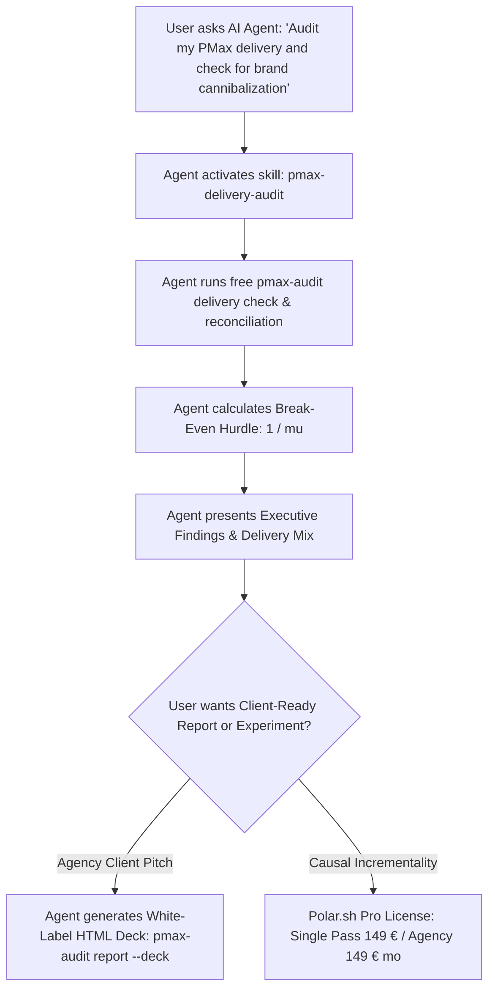

# PMax Sentry — Agent-First Community Traction & Placement Guide

**Target Core Persona:** Performance Marketing Agency Directors, Senior PPC Specialists, Fractional CMOs, and E-Commerce Growth Leads.  
**Core Conversion Flywheel:** Give away the open-source CLI and Agent Skill (`pip install pmax-sentry`); monetize the client-ready White-Label Audit Deck and Causal Incrementality Validation (`pmax-sentry-pro` via Polar.sh).

---

## 1. Persona Resonance Matrix & Core Frustrations

```
┌─────────────────────────────────────────────────────────────────────────────────┐
│ 1. Performance Marketing Agency Heads & PPC Leads (Mediaplus, pilot, Dept, etc.)│
│ • Frustration: PMax is a client-communication nightmare. Clients accuse the     │
│   agency of wasting budget on mobile games and low-quality YouTube slop.        │
│ • Vendor Anger: Fragile Looker Studio templates break on every API change.      │
│ • Resonance Hook: "Generate a White-Label PMax Audit Deck with real channel     │
│   reconciliation and break-even contribution economics in 10 seconds."          │
├─────────────────────────────────────────────────────────────────────────────────┤
│ 2. DTC / E-Commerce Scale-Up Heads of Growth (Shopify Plus, WooCommerce)        │
│ • Frustration: Google Ads reports a 4.2x ROAS, but actual bank cashflow and net │
│   profit are flat. PMax is claiming brand search and existing organic demand.   │
│ • Blind Spot: Not knowing if marginal PMax spend clears their variable hurdle.   │
│ • Resonance Hook: "Audit whether your PMax ROAS clears your true contribution   │
│   margin hurdle (1/μ) or if you are scaling unprofitable ad inventory."         │
├─────────────────────────────────────────────────────────────────────────────────┤
│ 3. Marketing Science & Econometrics Practitioners (Google Meridian / Robyn)     │
│ • Frustration: Table-subtraction scripts invent spend allocations that fail     │
│   Google Ads API v26 reconciliation.                                            │
│ • Resonance Hook: "Why channel-subtraction heuristics fail PMax reconciliation   │
│   (and how to structure causal geo-incrementality tests properly)."             │
└─────────────────────────────────────────────────────────────────────────────────┘
```

---

## 2. The Agent-First Distribution Mechanism

PMax Sentry is distributed **Agent-First**:



### Supported Agent Environments:
- **Claude Desktop & Cursor (via FastMCP):** Stdio MCP server `pmax-mcp` with 11 read-only tools.
- **Antigravity / Hermes Agents:** Bundled `.agents/skills/pmax-delivery-audit/SKILL.md` skill.
- **Python / CLI Analysts:** `pmax-audit` terminal CLI.

---

## 3. High-Signal Community Channels (Zero-Pitch, High-Value Entry)

### 3.1. Measure Slack (`#google-ads`, `#attribution`, `#tools-open-source`)
- **Scale:** 16,000+ data and marketing practitioners.
- **Entry Angle:** Share an open-source technical teardown on Google Ads API v26 segmentation:  
  *„Why subtracting search-term insight categories to calculate PMax brand spend breaks under API v26 — and how we reconcile unsegmented campaign totals against orthogonal channel × format dimensions in open-source Python.“*
- **Action:** Share GitHub repository and CLI usage. No sales pitch. Let the tool speak for itself.

### 3.2. r/PPC (Reddit — 150,000+ Media Buyers)
- **Pain Point:** PPC specialists constantly battle clients over Performance Max placements.
- **Entry Post Title:** *„I built an open-source tool to audit PMax delivery mix and reconcile campaign totals without fake table subtraction.“*
- **Content:** Include a screenshot of the Rich terminal table showing Channel × Format breakdown and the reconciliation audit status (`COMPLETE` vs `PARTIAL`).

### 3.3. MMM Hub Slack (`#tools-code`, `#data-prep`)
- **Scale:** Elite causal inference and marketing mix modeling engineers.
- **Entry Angle:** Discuss the connection between platform-reported ROAS, contribution margin $\mu$, and break-even hurdle $1/\mu$:  
  *„Why average ROAS fails to identify optimal PMax spend points, and how to preflight daily outcome data for spend variance ($CV \ge 0.05$) before attempting incrementality tests.“*

---

## 4. Phase 1: Landing the First 4 Agency Customers (Days 1–21)

To hit **500 €/month with < 1 hour/week**, the goal is **4 agency subscriptions à 149 €/month** (or 3 à 199 €/month).

### 4.1. The "VIP Agency Evaluation Pass" Outbound Outreach
Target 20 senior performance leads at boutique PPC agencies on LinkedIn (e.g. searching for *"Head of PPC"*, *"PMax Lead"*, *"Google Ads Director"* at agencies with 10–50 employees):

**Direct InMail Template:**
> *"Hi [Name], quick question on your agency's PMax workflow: When onboarding new e-commerce clients, how do your media buyers audit whether PMax is driving incremental sales versus just retargeting existing brand demand?*  
>  
> *We built an open-source tool (`pmax-sentry`) that reconciles Google Ads API v26 delivery mix across channels and formats, calculates the client's break-even margin hurdle (1/μ), and generates a 1-click standalone White-Label HTML pitch deck with your agency's logo.*  
>  
> *I’d love to gift you a complimentary 6-month Agency Pro license in exchange for 15 minutes of feedback on whether this helps your team win more new-business audits.*  
>  
> *No pitch, no contract. Let me know if you'd like a test key for an upcoming client audit!"*

### 4.2. Feedback Call Questions
1. *"When a prospective brand brings you their Google Ads account, what are the top 3 things you inspect in PMax?"*
2. *"Do your clients ask for brand cannibalization or incrementality data, and how do you explain the difference between platform ROAS and marginal return?"*
3. *"Would your account managers present an interactive HTML/PDF deck directly to the client if your agency branding was embedded?"*
4. *"If this saved your team 3 hours per audit and improved pitch conversion, would 149 €/month for unlimited client decks fit your software budget?"*

---

## 5. Monetization & Polar.sh Setup

- **Platform:** Polar.sh (handles EU VAT, automatic invoice delivery, Stripe checkout, license validation API).
- **Product Tiers:**
  - `Single Audit Pass`: **149 €** one-time (single customer ID, White-Label HTML Deck, Decision Contract).
  - `Agency Pro Retainer`: **149 € / month** (up to 50 connected accounts, unlimited pitch decks, experiment design protocols, priority updates).
- **License Enforcement:** Stateless Polar validation in `pmax_sentry_pro._auth` with local 24-hour HMAC-SHA256 cache bound to machine fingerprint.
